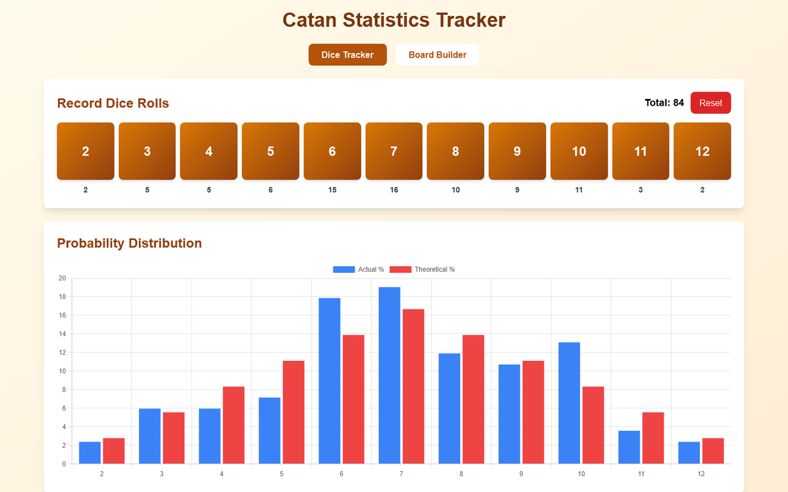
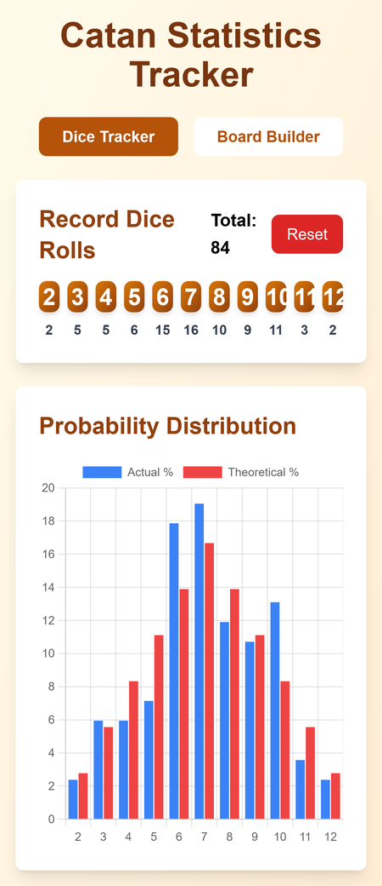
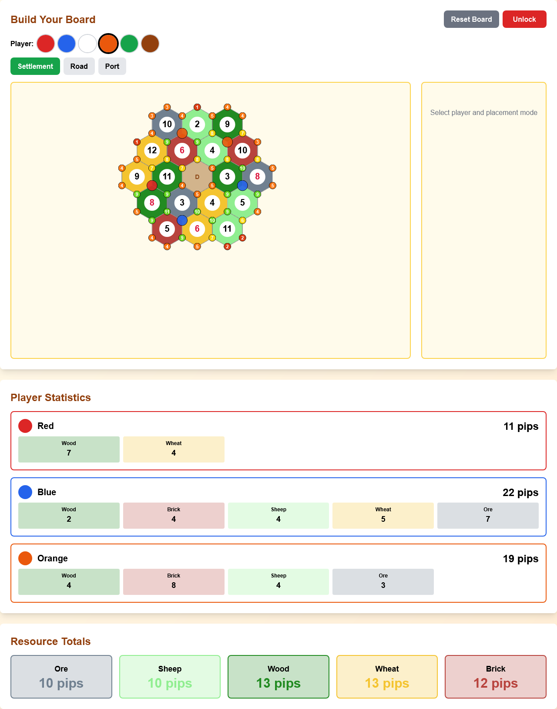

# Catan Statistics Tracker

Track the dice across a game of Catan and see how the real rolls stack up against the odds, then lay out your board to find the best settlement spots. Handy on a phone at the table.

**[▶ Open the live app](https://timothyhadfield.github.io/catan-statistics/)** · works on phone and laptop

  
  &nbsp;
  

## Features
- **One-tap dice tracker**: tap the number that was rolled (2 to 12) and the running count and total update right away.
- **Actual vs expected chart**: a bar chart puts each number's real share of rolls next to its textbook probability, so you can see which numbers are running hot or cold.
- **Board builder**: start from the standard 19-hex board, add or remove tiles to match any layout, and set each tile's resource and number.
- **Guided Auto Place**: step through each resource and number token and tap the matching tiles, instead of editing hexes one at a time.
- **Settlement spot scores**: lock the board and every corner shows its pip count, color-coded from weak (red) to strong (green).
- **Player planning**: place settlements, roads and ports for up to six colors and see each player's total pips per resource, plus the board's resource totals.

  

## Built with
A single HTML file: React 18 and Tailwind from a CDN, Chart.js for the chart, hosted on GitHub Pages.

## Running it

It's a single self-contained HTML file with no build step: open
[`index.html`](index.html) in a browser, or use the live link above.
